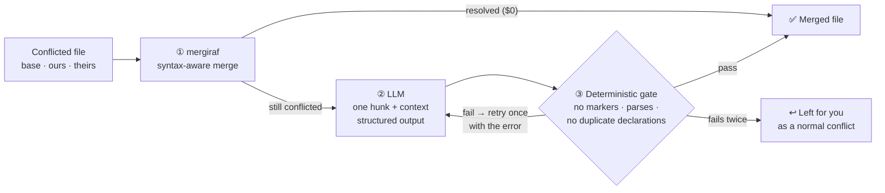
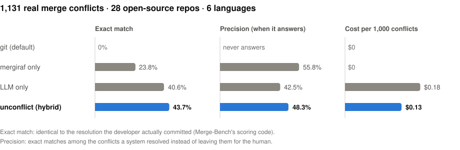

<h1 align="center">unconflict</h1>

<p align="center">
  <b>Resolves git merge conflicts automatically.</b><br>
  A syntax-aware merge goes first, an LLM handles only what's left,<br>
  and a deterministic safety gate checks every change.
</p>

<p align="center">
  <a href="https://github.com/khanak0509/unconflict/actions/workflows/tests.yml"></a>
  
  
  
  
</p>

<p align="center">
  
</p>

<table align="center">
  <tr>
    <td align="center"><h2>43.7%</h2>exact match with the developer's<br>real resolution <sub>(LLM alone: 40.6%)</sub></td>
    <td align="center"><h2>48.3%</h2>precision when it answers<br><sub>(LLM alone: 42.5%)</sub></td>
    <td align="center"><h2>25%</h2>cheaper than sending<br>every conflict to the LLM</td>
    <td align="center"><h2>9,013</h2>conflicts evaluated<br>in 11 languages</td>
  </tr>
</table>

---

## Why

Merge conflicts are a daily cost of working in a team. Structured merge tools like [mergiraf](https://mergiraf.org) are precise but leave most conflicts alone. LLMs attempt everything, but they're expensive at scale and can produce code that doesn't even parse. A 2026 study ([arXiv 2607.27674](https://arxiv.org/abs/2607.27674)) proposed combining the two, with deterministic checks as the safety net, but never tested it end to end.

**unconflict builds that pipeline, ships it as a git merge driver, and measures it on 9,013 real conflicts.**

## How it works



1. **Structured merge.** [mergiraf](https://mergiraf.org) merges at the syntax-tree level, so changes that git sees as overlapping lines merge cleanly: two imports added at the same spot, two new class members, edits to different parts of one expression. No API cost.
2. **LLM, only for what's left.** Each remaining conflict goes to the LLM (LangChain `ChatOpenAI` with structured output). It gets the three versions, up to 60 lines of context and the language, and returns the replacement code plus a "can't resolve safely" flag.
3. **Deterministic gate.** Plain code, no LLM: no leftover conflict markers, the file still parses with tree-sitter, and no import, function or class member is duplicated. A failure triggers one retry with the exact error. A second failure hands the conflict back to you.

**Review mode** is on by default. When the LLM was involved, git stops with clean, resolved code in the file instead of conflict markers. `git diff` shows exactly what was chosen, and `git add` accepts it.

## Quick start

```bash
# install
uv tool install git+https://github.com/khanak0509/unconflict      # or: pip install git+https://...
brew install mergiraf                                              # or: cargo install --locked mergiraf
export OPENAI_API_KEY=sk-...

# register as the merge driver in a repo (or --global for all repos)
cd your-repo
unconflict install

# from now on, git merge / git rebase use it automatically
git merge feature
```

Or run it on a file that already has conflict markers:

```bash
unconflict resolve src/app.py              # writes src/app.py.resolved, never touches the original
unconflict resolve src/app.py --in-place
unconflict resolve src/app.py --no-llm     # mergiraf only, free
```

<details>
<summary><b>Manual git configuration</b></summary>

```bash
git config merge.unconflict.name "unconflict: mergiraf + LLM + gate"
git config merge.unconflict.driver "unconflict driver %O %A %B %P -s %S -x %X -y %Y"
echo "*.py merge=unconflict" >> .gitattributes     # one line per file type
git config merge.conflictStyle diff3              # gives `unconflict resolve` the base version
```

To accept LLM resolutions without stopping for review: `unconflict install --auto`, or `UNCONFLICT_AUTO=1`.
</details>

## Features

- **Two ways to run it:** as a git merge driver for `merge`/`rebase`, or as a CLI on any conflicted file
- **11 languages:** Python, JavaScript, TypeScript, Java, Go, Rust, C, C++, C#, PHP, Ruby
- **Never silently overwrites work:** CLI output goes to a `.resolved` file by default, the driver stops for review after LLM edits, and uncertain conflicts are left for you
- **Hard spending cap:** every paid call reserves its worst-case cost first and is refused if the total would pass the cap. Spend is tracked in a local ledger (`unconflict spend`)
- **On-disk response cache:** re-resolving the same conflict costs nothing
- **Cheap by design:** about $0.0001 per conflict with `gpt-6-luna`, and $0 for everything mergiraf solves

## Results

<p align="center"></p>

### Real conflicts with full files (1,131 conflicts)

I mined these conflicts by replaying merge commits from 28 open-source repos taken from Merge-Bench's repo lists. Each one has the full file, the base version, and the resolution the developer actually committed.

| system | exact match | semantic match | precision | cost / conflict |
|---|---:|---:|---:|---:|
| git (default) | 0% | 0% | – | $0 |
| mergiraf only | 23.8% | 25.6% | 55.8% | $0 |
| LLM only | 40.6% | 43.9% | 42.5% | $0.00018 |
| **unconflict (hybrid)** | **43.7%** | **47.3%** | **48.3%** | **$0.00013** |

- **The hybrid beats the same LLM used alone** by +3.1 points exact match, a statistically significant gain (95% CI +0.2 to +5.9, file-clustered bootstrap). It's also more precise, at 25% lower cost.
- **mergiraf handles 41% of conflicts at $0** and is the most precise system on the conflicts it takes. On those, it was right 261 times where the LLM alone was right 191 times.
- **The safety gate rejected 199 LLM outputs** that would have left broken or duplicated code, and flagged mergiraf output that broke parsing or duplicated code in 17 files.
- **Abstaining is mostly a good call:** on the conflicts it handed back to the developer, LLM-only was wrong twice as often as it was right.

<details>
<summary><b>Exact match by language</b></summary>

| | Python | JavaScript | TypeScript | Java | Go | Rust |
|---|---:|---:|---:|---:|---:|---:|
| conflicts | 210 | 215 | 176 | 150 | 116 | 264 |
| mergiraf only | 25.2% | 26.5% | 26.1% | 28.0% | 31.0% | 13.3% |
| LLM only | 56.7% | 34.9% | 37.5% | 32.0% | 38.8% | 40.2% |
| unconflict (hybrid) | **65.7%** | **43.3%** | 35.8% | **36.0%** | **41.4%** | 37.1% |
</details>

### Official Merge-Bench benchmark (7,882 conflicts, 11 languages)

[Merge-Bench](https://github.com/benedikt-schesch/Merge-Bench) (UW, ICPR 2026) is a recent benchmark for LLM merge resolution. On its full test set, with its own scoring code, `gpt-6-luna` scored **42.6% exact / 50.7% semantic** for **$0.48 total**. For context, the paper reports Gemini 2.5 Pro at 47.1 / 52.6, Claude Opus 4 at 40.3 / 44.8 and o3 Pro at 39.2 / 45.1. The prompt format differs, so treat this as indicative.

<details>
<summary><b>By language (exact / semantic)</b></summary>

| C | Python | PHP | Java | JavaScript | Rust | C++ | Ruby | C# | Go | TypeScript |
|---|---|---|---|---|---|---|---|---|---|---|
| 64.7 / 70.1 | 51.4 / 54.2 | 49.2 / 59.0 | 44.8 / 59.2 | 44.3 / 55.3 | 40.3 / 45.5 | 39.7 / 51.6 | 35.2 / 37.9 | 35.1 / 53.1 | 34.9 / 35.8 | 33.7 / 38.2 |
</details>

**Total API spend for the whole project: $0.82**, covering development, testing and every evaluation run (10,071 LLM calls). Every number here comes from a saved run in [`results/`](results/) with its config, seed and cost. [METHODOLOGY.md](METHODOLOGY.md) has the full evaluation design.

## Project structure

```
src/unconflict/
  conflict.py     parse / render diff3 and 2-way conflict markers
  structured.py   stage 1: mergiraf (+ git merge-file baseline)
  llm.py          stage 2: LangChain ChatOpenAI with structured output
  gate.py         stage 3: markers, tree-sitter parse, duplicate declarations
  pipeline.py     orchestration: retry, abstain, per-hunk log
  budget.py       hard spending cap + spend ledger
  cache.py        on-disk LLM response cache
  cli.py          `unconflict resolve | driver | install | spend | warmup`
eval/             Merge-Bench loader, conflict miner, metrics, runner, analysis
tests/            68 tests with Python / JS / TS / Java fixtures, mocked LLM
demo/demo.sh      tiny repo, a real conflict, resolved end to end
```

```bash
uv sync && uv run pytest        # 68 tests, no network, no API calls
demo/demo.sh                    # end-to-end demo (add --no-llm for the free version)
```

## Tech stack

Python · LangChain (`langchain-openai`) · OpenAI structured outputs · mergiraf · tree-sitter · git merge drivers · pyarrow · pytest · GitHub Actions

## Credits

- **[Merge-Bench](https://github.com/benedikt-schesch/Merge-Bench)** (Benedikt Schesch and Michael D. Ernst, ICPR 2026): benchmark, repo lists, and the scoring code reused in `eval/metrics.py` (MIT)
- **[mergiraf](https://mergiraf.org)** (GPL-3.0): the structured merge in stage 1, called as a separate program
- **Bowen Shen**, *Can Large Language Models Resolve Real Java Merge Conflicts?* ([arXiv 2607.27674](https://arxiv.org/abs/2607.27674)): proposed the structured-first, LLM-fallback, deterministic-gate design tested here
